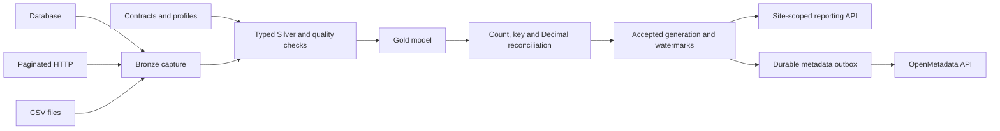

# Industrial Lakehouse Contracts

**Contract-driven ingestion, reconciled reporting and recoverable publication.**

I designed this project to address a recurring data-platform problem: a successful
load does not necessarily produce a dataset that reporting consumers can trust.
The implementation separates ingestion, validation and publication so that only
an accepted, reconciled generation becomes visible to consumers.

The use case is sales fulfillment across three industrial sites. Database tables,
a paginated HTTP service and CSV files feed a Bronze/Silver/Gold model, with
explicit contracts, blocking quality rules and exact monetary reconciliation.
All demonstration data is synthetic.

[Run the demonstration](docs/DEMO.md) · [Architecture](docs/ARCHITECTURE.md) ·
[Data model](docs/DATA_MODEL.md) · [Qualification baselines](docs/STATUS.md)

## Engineering focus

- **Reliable publication.** The accepted dataset pointer and watermarks advance
  together, after validation. A rejected or interrupted candidate is not a report.
- **Recoverable processing.** Frozen inputs, immutable artifacts and durable
  journals allow existing effects to be reconciled before retrying.
- **Metadata-driven ingestion.** Contracts describe entities, keys, types,
  ownership and classification; execution profiles select sources and engines.
  Business transformations remain reviewed code.
- **Governed consumption.** Reporting applies site scope before aggregation.
  A separate metadata publisher verifies owners, classifications, lineage and
  quality results through the OpenMetadata API.

## Architecture



The reference profile uses SQLite and immutable JSON. The native profile uses
PostgreSQL, PySpark, Delta Lake and an in-process Dagster job. Native reporting
consumes JSON projections reconciled against Delta. The catalogue integration
was qualified separately with accepted reference-profile generations.

## Quick start

Requirements: Git and Python **3.12 or 3.13**. Run from the cloned repository root.
The reference demonstration requires no database server or cloud account.

```bash
git clone https://github.com/mehdisafer/industrial-lakehouse-contracts.git
cd industrial-lakehouse-contracts
python -m venv .venv
```

Activate `.venv` with `source .venv/bin/activate` on Linux/macOS, or
`.\.venv\Scripts\Activate.ps1` in PowerShell. Then:

```bash
python -m pip install -e '.[test]'
python scripts/check_repository.py
python -m ilc.cli validate
python -m pytest
python scripts/qualify_reference.py --output .runtime/demo-001 --rows 10000
```

Open `.runtime/demo-001/evidence/report-recovered.html` and inspect
`qualification.json` in the same directory. The harness exercises nominal
processing, rejection and recovery. Use a new output directory for each run;
existing evidence is not overwritten.

For a guided reading of the outputs, use the [demonstration guide](docs/DEMO.md).
The [runbook](docs/RUNBOOK.md) covers native setup, catalogue execution and recovery.

## Evidence-backed capabilities

| Capability | Reviewed result |
|---|---|
| Native processing | PostgreSQL 16, PySpark/Delta 4.0.1 and Dagster 1.11.16 executed on CircleCI |
| Data reconciliation | 10,000 source records across five entities; 3,980 fact rows; counts, keys and monetary totals reconciled |
| Recovery | Controlled interruption after target materialization; frozen input and target reuse; one accepted replacement generation |
| Catalogue integration | OpenMetadata 1.12.0; two generations with 15 tables and 11 lineage edges each; quality results and server-side permission checks |

The [baseline register](docs/STATUS.md) identifies the exact executed commits.
The [qualification guide](docs/QUALIFICATION.md) separates unit tests, integration
scenarios, artifact review and remaining reservations.

## Design boundaries and next steps

I have deliberately qualified a bounded, single-host implementation before
extending it to a managed platform. Distributed throughput, high availability,
PostgreSQL/Delta disaster recovery and a combined native-to-catalogue run remain
separate work. Fabric/Power BI currently has a read-only inventory preflight;
its deployment and end-to-end qualification are on the [roadmap](docs/PROVIDER_GATES.md).

The custom contract format is not claimed to conform to ODCS. The business model
is explicitly scoped to EUR sales fulfillment; on-time shipped units are not an
order-level OTIF metric.

## Documentation and maintenance

Start with the [documentation index](docs/README.md). Changes follow the
[contribution guide](CONTRIBUTING.md), including source-revision evidence and
regression checks. See [security](SECURITY.md) for demonstration boundaries and
[licensing](docs/LICENSING.md) for the current reuse status. No open-source licence
has been granted for the original code.

Maintained by [Mehdi Safer](https://github.com/mehdisafer).
