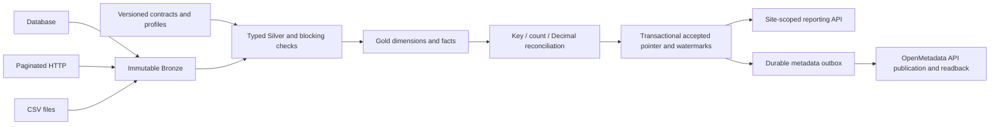

# Industrial Lakehouse Contracts

**A contract-driven data pipeline that publishes only reconciled, accepted reporting generations.**

I built this portfolio project around a fictional manufacturer operating three
sites. It demonstrates a concrete data-platform problem: ingest heterogeneous
sources, reject bad input, reconcile monetary totals, and recover interrupted
publication without exposing a partial dataset to reporting.

The implementation includes a lightweight reference path, a qualified native
PostgreSQL / PySpark / Delta / Dagster path, and a separately qualified real
OpenMetadata integration. All inputs and identifiers are synthetic.

## Start here

[Demonstration walkthrough](docs/DEMO.md) · [Architecture](docs/ARCHITECTURE.md) ·
[Qualification evidence](docs/QUALIFICATION.md) · [Runbook](docs/RUNBOOK.md) ·
[Remaining work](docs/PROVIDER_GATES.md)

| Capability | Evidence and scope |
|---|---|
| Database, paginated HTTP and CSV ingestion | Five contracted entities; bounded capture and immutable source inventory |
| Data quality and exact reconciliation | Duplicate keys, invalid amounts and schema drift block publication; Decimal/count/key checks |
| Native data processing | PostgreSQL 16, PySpark/Delta 4.0.1 and Dagster 1.11.16 executed on CircleCI; [G2 review](docs/evidence/NATIVE_fc1a928_REVIEW.md) |
| Recovery and reporting | Controlled post-target process exit, source HTTP offline, Bronze/target reuse, generation 2 served |
| Real catalogue integration | OpenMetadata 1.12.0; two generations, schemas/owners/tags/lineage/DQ, server-role denials and delivery recovery; [G3a review](docs/evidence/OPENMETADATA_cd09de0_REVIEW.md) |
| Reference backup/restore | SQLite same-path restoration, not PostgreSQL/Delta disaster recovery |
| Fabric / Power BI | Read-only inventory preflight only; implementation and tenant qualification remain open |
| Scale and production | Single-host synthetic qualification, **not** a Big Data benchmark or production-readiness claim |

## How it works



A candidate is not a published generation. The accepted pointer, watermarks and
receipt are committed only after validation. Native execution rereads all ten
Delta tables at their final path before acceptance. If publication is interrupted,
the next invocation reconciles existing effects rather than blindly repeating them.

The reference profile uses SQLite and immutable JSON datasets. The native profile
uses PostgreSQL, Spark SQL, Delta and an in-process Dagster job. Reporting consumes
JSON projections reconciled against Delta, not Direct Lake. Catalogue integration
was tested with fresh accepted **reference** generations; the native and catalogue
runs are separate, not a claimed combined execution.

## Run a reproducible demonstration

Use Python 3.12 or 3.13, a new virtual environment and a fresh output directory.
No cloud account or real business data is needed for the reference route.

```bash
python -m venv .venv
# Linux/macOS: source .venv/bin/activate
# PowerShell: .\.venv\Scripts\Activate.ps1
python -m pip install -e '.[test]'
python -m ilc.cli validate
python -m pytest --junitxml=artifacts/junit.xml
python scripts/qualify_reference.py --output .runtime/demo-001 --rows 10000
python scripts/qualify_recovery_governance.py --output .runtime/recovery-001 --rows 10000
```

The scripts refuse existing output directories. Read their `evidence/` receipts
and generated report rather than treating file existence as success. Keep `work/`,
source databases, bearer policies and runtime credentials out of Git. Native and
catalogue prerequisites are documented in the [runbook](docs/RUNBOOK.md).

## What the reviewed demonstration produced

| Measure | Initial generation | Recovered/revised generation |
|---|---:|---:|
| Captured records across five entities | 10,000 | 10,000 |
| Orders | 995 | 995 |
| Fact rows | 3,980 | 3,980 |
| Ordered amount, EUR | 8,857,766.18 | 8,857,786.18 |
| Backlog amount, EUR | 3,387,718.88 | 3,387,738.88 |

The +20 EUR change is an intentional fixture revision on SITE_A, not duplicated
orders. On-time quantity counts shipped units delivered by the promised timestamp;
it is not order-level OTIF. No currency conversion is performed. Fixed fixture
time means a correctly accepted report can be `STALE`. A rejected subsequent load
exposes `DEGRADED` while preserving the last accepted dataset.

The native run selected **one pytest test** (234 deselected) and separately ran
six application scenarios. The catalogue run executed **33 offline safeguard tests**
and six separate live-product scenarios. The catalogue review reconciled 30 remote
tables, 170 column definitions, 22 lineage edges, two DQ results and two basic suites.
Counts from different runs and test layers are not added together.

## Engineering decisions

- **Metadata-driven, not arbitrary execution:** reviewed profiles and contracts
  select known operations. Extra compatible ingestion entities do not automatically
  invent new Gold metrics or universal reporting.
- **Explicit acceptance:** strict typing, source accounting, row/business checks
  and independent count/key/Decimal reconciliation precede consumer publication.
- **Recovery before retry:** frozen inputs, durable journals and metadata outbox
  distinguish unknown effects, verified effects and conflicts.
- **Verifiable boundaries:** every proof retains its commit, source profile and
  exclusions; protocol emulation is never labelled real-product qualification.

See [contracts](docs/CONTRACTS.md), [recovery](docs/RECOVERY.md),
[governance](docs/GOVERNANCE.md), [security](docs/SECURITY.md) and
[CircleCI controls](docs/CI_CIRCLECI.md).

## Evidence, limitations and roadmap

Native G2 is accepted at `fc1a9286c937deb09b87b97524c6835b24a1d516`.
Catalogue G3a is accepted at `cd09de03d658cb66d5aaa29a8ec677fd17a3f977` after
reconciliation of supplied artifacts. Fourteen native JSON hashes and fifteen
catalogue artifact hashes agree with their manifests. These are reviewed copied
outputs, not signed provenance or an independent maintainer approval. Original
browser-rendered JUnit bytes and actual credit accounting remain reservations.

Current limits include Spark `local[2]`, whole-source bounded capture before
incremental selection, no CDC/delete capture, no multi-host writer fencing, no
HA and no PostgreSQL/Delta restore. OpenMetadata roles were checked on a dedicated
instance, not for multi-tenant namespace isolation. TLS/SSO, SDK/Airflow ingestion
and product-UI review are not part of the catalogue gate.

Fabric → Power BI remains a distinct planned integration requiring an explicitly
authorized tenant, workspace, capacity, roles and budget. This portfolio preview
does not silently remove that requirement or claim a deployed vendor solution.
P01 remains active; the next portfolio projects are not bundled into this release.

## Publication and reuse

This is a **portfolio preview**, not a production distribution. The
[publication checklist](docs/PUBLICATION.md) separates functional evidence,
repository disclosure and live-service deployment. CircleCI is the automatic CI
route; optional GitHub Actions workflows are manual to avoid duplicate execution.
No default-admin test service is intended for public Internet exposure.

No open-source licence has been selected or granted for this original code.
See [licensing and third-party scope](docs/LICENSING.md); dependency and container
licences remain their own. Contributions should not contain employer/client code,
real records, credentials or confidential infrastructure details.

**Résumé français.** Projet de portfolio de Data Engineering : ingestion pilotée
par contrats, qualité bloquante, réconciliation exacte, reporting sur la dernière
génération acceptée et reprise contrôlée. Le moteur natif et l'intégration API
OpenMetadata ont chacun des preuves d'exécution distinctes. Fabric/Power BI,
la charge distribuée et l'exploitation en production ne sont pas présentés
comme réalisés.
