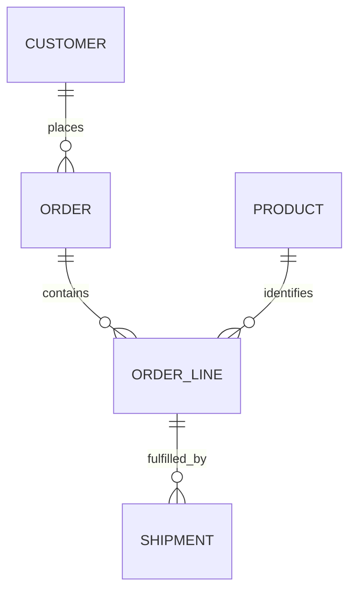

# Sales fulfillment model

## Business question and reporting grain

The model answers: **what has been ordered, what has shipped on time, and what
remains to ship for each authorised site?** I use the order line as the fact grain
so partial shipments can be reconciled without duplicating ordered amounts.

The implementation contract is [sales.json](../contracts/sales.json). Its
`gold_model` is `sales_fulfillment_v1`; this is a reviewed model, not arbitrary SQL
loaded from metadata. Every bundled entity is `PUBLIC_SYNTHETIC` and owned by the
`synthetic-data-owner` role.

## Sources and keys

| Entity | Business key | Source | Load mode |
|---|---|---|---|
| Customers | `customer_id` | Database | Full |
| Products | `product_id` | CSV | Full |
| Orders | `order_id` | Database | Incremental |
| Order lines | `order_id`, `line_id` | Database | Incremental |
| Shipments | `shipment_id` | Paginated HTTP | Incremental |

These assignments come from the [reference profile](../profiles/reference.json).
The [native profile](../profiles/native.json) changes the database, execution and
state backends, not the business definition. All entities use `updated_at` in UTC.
The current incremental lookback is 300 seconds; both interval endpoints are
inclusive. Capture is bounded and whole-source before incremental selection.
Physical deletes and updates older than the lookback need a separate strategy.



The relationships reflect the implemented referential checks. An order without
lines is not itself rejected by a minimum-cardinality rule.

## Silver quality rules

The contract rejects unknown/missing fields, invalid types, nulls in required
fields, unsupported site/currency values and invalid primary keys. Duplicate-key
members are quarantined rather than silently selecting one. Same-key updates with
the same timestamp but different payloads are conflicts.

The business checks enforce:

- An order references a known customer and the same site; the site belongs to the contract.
- An order line references a known order and product, and its amount equals quantity times unit price at the declared monetary scale.
- A shipment references an existing order line; cumulative shipped quantity cannot exceed ordered quantity.

Any blocking row, schema or business failure prevents publication and watermark
advancement. The previous accepted generation stays available. The code is in
[contracts.py](../src/ilc/contracts.py) and [transform.py](../src/ilc/transform.py).

## Gold datasets and measures

| Dataset | Grain |
|---|---|
| `dim_customer` | Customer snapshot |
| `dim_product` | Product snapshot |
| `dim_site` | Site declared in the contract |
| `fact_order_fulfillment` | One row per `(order_id, line_id)` |
| `site_kpi` | One row per site represented in the facts |

For an order line:

```text
shipped_qty    = sum of shipment quantities for that line
on_time_qty    = sum of quantities delivered at or before the order's promised_at
backlog_qty    = ordered quantity - shipped_qty
ordered_amount = the validated line amount
backlog_amount = backlog_qty * unit_price
```

Site quantities and amounts sum the fact rows. `order_count` counts distinct
orders within the site; `line_count` counts fact rows. Reporting filters by
permitted site before calculating totals. Money uses exact decimal semantics;
the reference SQL path uses integer cents and an independent Decimal reconciliation.

This contract accepts EUR only. It performs no currency conversion and models no
tax, discount, return or cancellation workflow. `on_time_qty` measures units, not
order-level OTIF. Dimensions are current accepted snapshots, not SCD Type 2 history.

## Acceptance, reconciliation and freshness

Source and Gold must agree on line counts, business-key sets and exact monetary
totals. Native acceptance also requires Delta re-reading at the final target path.
The accepted batch, contract and target fingerprints accompany the report.

`ACCEPTED` describes publication eligibility. `STALE` describes dataset age against
the configured 3,600-second freshness budget. `DEGRADED` records a rejected latest
attempt while preserving the previous accepted report. These states answer
different questions and are intentionally visible to consumers.

The reviewed clean fixture has 30 customers, 20 products, 995 orders, 3,980 lines
and 4,975 shipments: **10,000 records in total**, not per table. Its intentional
revision changes SITE_A by 20 EUR without increasing the order or fact count.
See the [native review](evidence/NATIVE_fc1a928_REVIEW.md) for the measured result.
